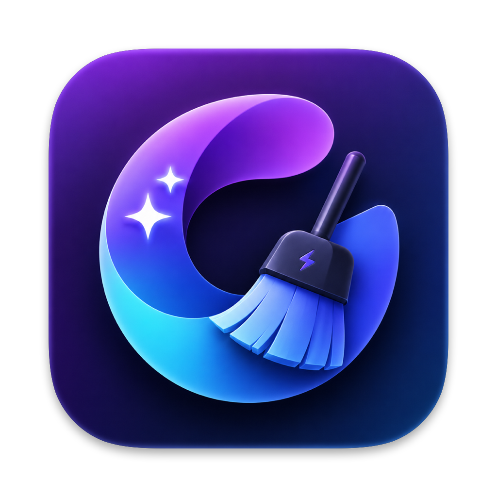

<p align="center">
  
</p>

<h1 align="center">Mac Sai</h1>

<p align="center">
  <strong>Il pulitore, ottimizzatore e scanner anti-malware open source per Mac.</strong><br>
  Un'alternativa gratuita a CleanMyMac, notarizzata da Apple, realizzata con Swift 6 e SwiftUI.<br>
  <sub>Scaricato oltre 125.000 volte. Gratis per sempre, con zero telemetria.</sub>
</p>

<p align="center">
  <a href="README.md">English</a> | <a href="README.zh-CN.md">简体中文</a> | <a href="README.zh-Hant.md">繁體中文</a> | <a href="README.de.md">Deutsch</a> | <a href="README.fr.md">Français</a> | <a href="README.ru.md">Русский</a> | <a href="README.es.md">Español</a> | <strong>Italiano</strong> | <a href="README.pt-BR.md">Português (Brasil)</a> | <a href="README.ja.md">日本語</a> | <a href="README.ko.md">한국어</a> | <a href="README.tr.md">Türkçe</a>
</p>

<p align="center">
  <a href="https://github.com/iliyami/MacSai/releases/latest"></a>
  <a href="https://github.com/iliyami/MacSai/stargazers"></a>
  <a href="https://formulae.brew.sh/cask/mac-sai"></a>
  <a href="https://github.com/iliyami/MacSai/releases/latest"></a>
  <a href="https://github.com/iliyami/MacSai/graphs/commit-activity"></a>
  <br>
  
  
  
  
  <a href="https://github.com/iliyami/MacSai/actions/workflows/ci.yml"></a>
  <a href="LICENSE"></a>
</p>

<p align="center">
  
</p>

<p align="center">
  <strong>Installalo con un solo comando:</strong>
</p>

```bash
brew install --cask mac-sai
```

<p align="center">
  Oppure scarica l'<a href="https://github.com/iliyami/MacSai/releases/latest">ultimo DMG</a>. È notarizzato da Apple, quindi si apre e basta: niente clic destro, niente avvisi, niente Terminale.
</p>

<p align="center">
  <sub>Nessuna pubblicità nell'app, mai. Questa pagina ha <a href="SPONSORS.md">un solo spazio sponsor selezionato</a>, ed è libero.</sub>
</p>

---

## Perché Mac Sai?

Un pulitore per Mac completo non dovrebbe costare un abbonamento annuale né chiederti di affidare a una scatola nera un accesso profondo ai tuoi file. Mac Sai ti offre l'intero kit di strumenti, alla luce del sole.

- **Gratis, per sempre.** Nessun abbonamento, nessun acquisto in-app, nessun "passa a Pro", nessuna schermata insistente. Licenza BSD-3.
- **Zero telemetria.** Niente analytics, niente crash reporter, niente tracker, nessun server a cui inviare dati. E non devi crederci sulla parola: [verificalo tu stesso](#verifica-tu-stesso-lassenza-di-telemetria) con due comandi.
- **Tutti i principali strumenti di CleanMyMac, in un'unica app.** 22 moduli tra pulizia, protezione, prestazioni, applicazioni e analisi del disco, più un widget nella barra dei menu.
- **Sicuro per progettazione.** Eliminazione prima nel Cestino, una blocklist di percorsi protetti, protezioni contro symlink e TOCTOU, e un `SafetyGuard` che convalida ogni percorso. È costruito per non perdere mai i tuoi dati.
- **Notarizzato da Apple e completamente open source.** Il tuo Mac verifica la firma a ogni avvio, e ogni riga di codice è qui da leggere.

---

## Funzionalità in breve

<table>
<tr>
<td width="33%" valign="top">

### 🧹 Pulizia
- **Smart Scan** (un clic)
- **System Junk** (16+ categorie)
- **Mail Attachments**
- **Trash Bins**
- **Project Junk** (cartelle di build)
- **Disk Hogs** (Docker, simulatori)
- **Clean History** (ripristino in un clic)

</td>
<td width="33%" valign="top">

### 🛡️ Protezione
- **Malware Removal**
- **Privacy** (browser)
- **Browser Extensions**
- **Saved Wi-Fi**
- **Permissions Overview**

</td>
<td width="33%" valign="top">

### ⚡ Prestazioni
- **Optimization** (elementi di login)
- **Maintenance** (attività di sistema)

</td>
</tr>
<tr>
<td width="33%" valign="top">

### 📦 Applicazioni
- **Uninstaller** (+ Reset to Defaults)
- **Unused Apps**
- **Extensions** (pannelli, plug-in)
- **Updater**

</td>
<td width="33%" valign="top">

### 🗂️ File
- **Space Lens** (treemap del disco)
- **Large & Old Files**
- **Duplicates** (+ Consolidate)
- **Shredder**

</td>
<td width="33%" valign="top">

### 📊 Barra dei menu
- CPU / memoria / disco / batteria in tempo reale
- Rete, tempo di attività, swap
- Consigli pratici

</td>
</tr>
</table>

---

## Funzionalità in dettaglio

### 🧹 Pulizia
| Modulo | Cosa fa |
|--------|------------|
| **Smart Scan** | Un solo clic esegue insieme i moduli di pulizia, protezione e prestazioni con l'avanzamento in tempo reale, poi mostra esattamente quanto spazio ha liberato ciascun modulo |
| **System Junk** | 16+ categorie di scansione: cache utente e di sistema, log, file di lingua, preferenze danneggiate, elementi di login non validi, versioni dei documenti, backup iOS, file inutili di Xcode, cache di gestori di pacchetti / IDE / strumenti di IA, residui di utenti eliminati e **assottigliamento dei binari Universal** (trova i binari Mach-O "fat" che contengono sia arm64 sia x86_64 e li riscrive per la tua architettura nativa tramite `lipo`, rispettando l'annullamento) |
| **Mail Attachments** | Trova gli allegati in cache di Apple Mail, Outlook e Spark |
| **Trash Bins** | Svuota il Cestino in ogni posizione, compresi i dischi esterni |
| **Project Junk** | Trova le cartelle di build rigenerabili nei tuoi progetti: `node_modules`, `.next`, `dist`, `target` di Rust e Maven, `build` di Gradle, virtualenv di Python e `Pods` di CocoaPods. Una cartella viene considerata solo quando i file accanto confermano il tipo di progetto, e `dist` e `Pods` solo quando il tuo `.gitignore` li nomina. Tutto finisce nel Cestino |
| **Disk Hogs** | Mostra quanto spazio occupano Docker e i simulatori di Xcode. Elimina i container fermi, le immagini orfane e la cache di build orfana (ciascuno dietro una conferma), e cancella i simulatori non disponibili e i vecchi runtime dei simulatori. I volumi Docker e il runtime più recente di ogni piattaforma non vengono mai toccati |
| **Clean History** | Elenca le tue pulizie recenti (ultimi 30 giorni, fino a 20) e riporta un'intera pulizia fuori dal Cestino con un clic. La cronologia resta sul tuo Mac in `~/Library/Logs/MacClean/clean-history.json`, leggibile solo dal tuo account utente, e non viene mai inviata da nessuna parte |

### 🛡️ Protezione
| Modulo | Cosa fa |
|--------|------------|
| **Malware Removal** | Scansione basata su firme a 3 livelli di profondità (Rapida / Bilanciata / Approfondita): launch agent e daemon, bundle di app, estensioni del browser e pattern noti di adware/malware. Corrispondenza esatta degli hash con le firme XProtect di Apple già presenti sul tuo Mac, offline, più un feed di hash MalwareBazaar (abuse.ch) facoltativo. Le estensioni di Safari presenti nella blocklist di Apple e le corrispondenze di MalwareBazaar vengono elencate per una tua verifica, mai preselezionate (non è un antivirus, e lo dice chiaramente) |
| **Privacy** | Pulisce cronologia, cookie e cache di Safari, Chrome e Firefox, con filtri temporali. I **segnalibri di Safari non vengono mai toccati** |
| **Browser Extensions** | Elenca le estensioni installate in Safari, Chrome, Brave, Edge, Arc e Firefox. Le estensioni di Chromium e Firefox che hai installato tu possono finire nel Cestino mentre quel browser è chiuso; quelle installate tramite policy o dal browser stesso vengono mostrate ma lasciate stare. Le estensioni di Safari rimandano alle impostazioni di Safari |
| **Saved Wi-Fi** | Elenca le tue reti wireless preferite e dimentica quelle che scegli |
| **Permissions Overview** | Una vista in sola lettura, organizzata per app, dei permessi privacy (TCC) concessi a ciascuna app, la prospettiva che Impostazioni di Sistema non ti offre. Ogni azione apre direttamente Impostazioni di Sistema, che gestisce gli interruttori |

### ⚡ Prestazioni
| Modulo | Cosa fa |
|--------|------------|
| **Optimization** | Gestisci elementi di login e launch agent, attivandoli o disattivandoli uno per uno |
| **Maintenance** | Attività di sistema: liberare RAM, eseguire gli script di manutenzione, verificare il disco di avvio, ricostruire Launch Services, reindicizzare Spotlight, svuotare la cache DNS, sfoltire le istantanee di Time Machine. Le attività sono etichettate per gravità, "Esegui attività sicure" procede in sequenza e la password di amministratore viene chiesta **una sola volta** |

### 📦 Applicazioni
| Modulo | Cosa fa |
|--------|------------|
| **Uninstaller** | Un motore di pattern matching che trova ogni file associato in oltre 17 sottocartelle di Library (comprese le app annidate nelle sottocartelle dei produttori). Rimozione completa, **Reset to Defaults** (cancella cache e preferenze di un'app mantenendo l'app) e rilevamento delle app inutilizzate |
| **Unused Apps** | Trova le app che non apri da 3, 6 o 12 mesi, usando la data di ultimo utilizzo di Spotlight, ordinate per dimensione. Le app in esecuzione non vengono mai elencate, e quando Spotlight non ha dati di utilizzo lo dice invece di tirare a indovinare. Con un clic passi un'app all'Uninstaller |
| **Extensions** | Esamina pannelli delle preferenze di terze parti, Internet Plug-In ed estensioni di Safari. I pannelli e i plug-in installati dall'utente possono finire nel Cestino |
| **Updater** | Controlla gli aggiornamenti delle app installate tramite i loro feed appcast Sparkle (legge solo le informazioni sulla versione, non invia nulla su di te) |

### 🗂️ File
| Modulo | Cosa fa |
|--------|------------|
| **Space Lens** | Visualizzazione dell'uso del disco con treemap squarificata e navigazione a livelli |
| **Large & Old Files** | Trova i file oltre i 50 MB, ordinati per dimensione e data dell'ultimo accesso |
| **Duplicates** | Rilevamento progressivo (raggruppamento per dimensione, SHA-256 parziale, hash completo, verifica dell'inode), più una modalità **Consolidate** che recupera spazio con cloni copy-on-write di APFS senza eliminare nemmeno una copia |
| **Shredder** | Cancellazione sicura dei file con le modalità standard, definitiva e sovrascrittura sicura |

### 📊 Widget della barra dei menu

<p align="center">
  
</p>

Un widget in stile glassmorphism nella barra dei menu che mette i parametri vitali del tuo Mac a un clic di distanza. È un processo indipendente che si avvia al login e si attiva o disattiva dalla barra laterale dell'app, così non devi mai aprire la finestra principale solo per dare un'occhiata.

- **Anelli statistici in tempo reale**: carico della CPU, pressione della memoria, uso del disco e batteria in una griglia di anelli 2x2 (`host_processor_info`, `vm_statistics64`, capacità APFS, fonte di alimentazione IOKit), con colori che sfumano dal verde all'ambra al rosso
- **Indicatore configurabile**: mostra lo spazio libero su disco, l'uso della GPU, l'uso della memoria o la temperatura della batteria; la scelta viene ricordata, e i sensori non disponibili mostrano `--`
- **Rete, tempo di attività e swap**: velocità di upload/download in tempo reale, tempo di attività del sistema, uso dello swap
- **Consigli**: suggerimenti pratici e ignorabili ("Le cache utente sono cresciute a 2,52 GB, esegui System Junk"), un tocco per agire, nascosti per 30 giorni dopo averli ignorati
- **Stato della protezione**: ora dell'ultima scansione anti-malware e numero di minacce, con un colore che indica quanto è recente
- **Dispositivi collegati**: volumi esterni (con lo spazio libero) e monitor a colpo d'occhio
- **Avvisi sullo stato**: notifiche limitate e facoltative quando lo spazio su disco è criticamente basso o la pressione della memoria resta alta

### ⌨️ Scorciatoie da tastiera

| Scorciatoia | Azione |
|----------|--------|
| **⌘R** | Avvia una scansione nel modulo corrente |
| **⌘K** | Pulisci la selezione corrente (quando sono visibili i risultati) |
| **Da ⌘1 a ⌘9** | Vai ai primi nove moduli della barra laterale |
| **⌘,** | Apri Impostazioni |

---

## Come si confronta Mac Sai

|  | Mac Sai | CleanMyMac | Pearcleaner | PureMac | OnyX | Mole |
|---|:---:|:---:|:---:|:---:|:---:|:---:|
| **Prezzo** | Gratis | $39.95/anno | Gratis | Gratis | Gratis | Gratis (CLI) |
| **Open source** | ✅ BSD-3 | ❌ | ✅ Fair-code | ✅ MIT | ❌ | ✅ MIT |
| **Telemetria** | ❌ Nessuna | ⚠️ Sì | ❌ Nessuna | ❌ Nessuna | ❌ Nessuna | ❌ Nessuna |
| **App nativa con GUI** | ✅ | ✅ | ✅ | ✅ | ✅ | ❌ CLI (GUI a pagamento separata) |
| **Smart Scan (un clic)** | ✅ | ✅ | ❌ | ➖ Parziale | ❌ | ➖ CLI interattiva |
| **System Junk (16+ categorie)** | ✅ | ✅ | ➖ | ✅ | ➖ Limitato | ✅ |
| **Assottigliamento dei binari Universal** | ✅ | ✅ | ❌ | ❌ | ❌ | ❌ |
| **Scanner anti-malware** | ✅ | ✅ | ❌ | ❌ | ❌ | ❌ |
| **Pulizia della privacy dei browser** | ✅ | ✅ | ❌ | ❌ | ➖ | ❌ |
| **Disinstallazione con rilevamento dei residui** | ✅ | ✅ | ✅ Specializzato | ❌ | ❌ | ✅ |
| **Ricerca duplicati (+ consolidamento)** | ✅ | ➖ | ❌ | ❌ | ❌ | ❌ |
| **Visualizzatore treemap del disco** | ✅ | ❌ | ❌ | ❌ | ❌ | ➖ Analizzatore |
| **Monitor di sistema nella barra dei menu** | ✅ | ✅ Menu | ❌ | ❌ | ❌ | ❌ |
| **Script di manutenzione** | ✅ | ✅ | ❌ | ❌ | ✅ Completo | ➖ |
| **Notarizzato da Apple** | ✅ | ✅ | ✅ | ✅ | ✅ | N/D |
| **Versione di macOS** | 14+ | 13+ | 13+ | 13+ | variabile | variabile |

> CleanMyMac è un ottimo prodotto, e chi desidera un'esperienza curata e supportata dovrebbe pagarlo volentieri. Mac Sai è per chi preferisce codice sorgente trasparente e nessun abbonamento.

---

## Lingue dell'interfaccia

Scegli Sistema, English, 简体中文, 繁體中文, Русский, Deutsch, Français, Español, Italiano, Português (Brasil), Türkçe, 日本語 o 한국어 in Impostazioni → Lingua interfaccia. Inglese, cinese semplificato e russo coprono l'intera interfaccia. Le altre lingue traducono le stringhe statiche dell'interfaccia; per ora i messaggi con valori interpolati mantengono il testo e le regole del plurale in inglese (il cinese tradizionale ripiega sul cinese semplificato). La finestra principale e il widget della barra dei menu condividono la preferenza della lingua.

## Installazione

### Homebrew (consigliato)

Mac Sai è nel cask ufficiale di Homebrew, quindi non serve alcun tap:

```bash
brew install --cask mac-sai
```

È notarizzato da Apple, quindi si avvia da Spotlight o da Applicazioni senza avvisi e senza passaggi aggiuntivi.

<details>
<summary><strong>Altri modi per installarlo</strong> (script di una riga, DMG, compilazione dal sorgente)</summary>

<br>

**Installer in una riga**

```bash
curl -fsSL https://raw.githubusercontent.com/iliyami/MacSai/main/scripts/install.sh | bash
```

Scarica l'ultimo DMG e installa l'app in `/Applications`.

**Download del DMG**

Scarica l'ultimo DMG da [Releases](https://github.com/iliyami/MacSai/releases/latest) e trascina Mac Sai nella cartella Applicazioni.

**Compilazione dal sorgente**

```bash
git clone https://github.com/iliyami/MacSai.git
cd MacSai
swift build
swift test                     # run the full 1,048-test suite
bash scripts/build-dmg.sh      # build a local DMG (unsigned)
```

Richiede la toolchain di Swift 6 (Xcode 16+).

**Installato tramite il vecchio tap?**

Mac Sai ora è nel cask ufficiale, quindi puoi rimuovere il tap: `brew untap iliyami/macsai` (l'app installata e i futuri `brew upgrade` non ne risentono).

</details>

### Concedere l'accesso completo al disco

Alcuni moduli (Mail Attachments, Privacy, Malware) hanno bisogno dell'accesso completo al disco per analizzare le aree protette:

1. Apri **Impostazioni di Sistema, Privacy e sicurezza, Accesso completo al disco**
2. Fai clic su **+** e aggiungi **Mac Sai.app**
3. Riavvia Mac Sai

### Disinstallazione

Installazione tramite Homebrew:

```bash
brew uninstall --zap --cask mac-sai
```

Installazione da DMG o manuale (gestisce anche un'installazione tramite Homebrew):

```bash
curl -fsSL https://raw.githubusercontent.com/iliyami/MacSai/main/scripts/uninstall.sh | bash
```

Entrambi rimuovono Mac Sai insieme a preferenze, cache, log e database in `~/Library`.

---

## Firmato, notarizzato e degno della tua fiducia

Mac Sai è firmato con un **Developer ID** Apple e **notarizzato da Apple**. Per un'app di pulizia questo conta più che per quasi qualsiasi altra cosa tu installi, perché stai per darle un accesso profondo ai tuoi file, e hai il diritto di sapere che ciò che gira sul tuo Mac è davvero nostro e non è stato manomesso. Tutto questo viene garantito dal tuo stesso Mac, non solo promesso da noi:

- **Apple l'ha analizzato.** Ogni release viene inviata ad Apple e controllata alla ricerca di malware prima della pubblicazione.
- **Non può essere manomesso.** La firma è un sigillo crittografico su ogni file; basta modificare un solo byte e macOS si rifiuta di aprirlo.
- **Viene dimostrabilmente da noi.** La firma è legata alla nostra identità di sviluppatore Apple, quindi nessun altro può distribuire qualcosa che il tuo Mac accetti come Mac Sai.
- **Funziona e basta.** Nessun avviso di Gatekeeper, nessun clic destro per aprirlo, nessun Terminale.

Insieme a un codice completamente open source, questa è una catena di fiducia che non devi accettare sulla fiducia: il codice è pubblico, firmiamo ogni release, Apple la verifica e il tuo Mac ricontrolla il sigillo ogni volta che apri l'app.

### Verifica tu stesso l'assenza di telemetria

Non crederci sulla parola. Sia il codice sorgente sia il processo in esecuzione si possono controllare.

**1. Cerca le API di rete nel codice sorgente**

```bash
rg -n 'URLSession|NSURLConnection|Sparkle|SecTrustEvaluate' Sources --glob '*.swift'
```

I percorsi di rete facoltativi sono indicati qui sotto. La pulizia locale non carica risultati delle scansioni né elenchi di file:

- `Sources/MacClean/Services/SelfUpdateController.swift`: Sparkle controlla il feed HTTPS sigillato nell'app firmata e scarica note di rilascio e archivi di aggiornamento firmati. Il controllo automatico e il download/installazione automatici sono impostazioni separate; la profilazione del sistema e il JavaScript nelle note di rilascio sono disattivati. Vedi la [configurazione degli aggiornamenti](docs/IN_APP_UPDATES.md). Per le installazioni dirette configurate, il controllo automatico degli aggiornamenti è attivo per impostazione predefinita e avviene una volta al giorno; ogni richiesta include le versioni dell'app e di Sparkle nello User-Agent, e i controlli si possono disattivare in Impostazioni.
- `Sources/MacCleanKit/UpdateChecker.swift`: i controlli degli aggiornamenti di Homebrew e il ripiego sulla pagina delle release per le build senza un feed firmato configurato
- `Sources/MacClean/Modules/Updater/UpdaterModule.swift`: il controllo, avviato da te, dei feed Sparkle *di altre app* quando apri l'Updater
- `Sources/MacCleanKit/MalwareBazaarFeed.swift`: il download facoltativo degli hash di MalwareBazaar. Viene eseguito solo quando aggiungi la tua Auth-Key di abuse.ch e premi Aggiorna ora in Impostazioni > Database di malware. Ogni richiesta invia solo la tua Auth-Key e la query, mai hash o percorsi di file. Quando un hash scaricato corrisponde a un file firmato, macOS chiede ad Apple se il suo certificato di firma è stato revocato, lo stesso controllo che fa Gatekeeper; quella richiesta riguarda il certificato, non i tuoi file

Non c'è alcun SDK di analytics, crash reporter o tracker in tutto il codice.

**2. Osserva il processo in esecuzione**

```bash
(
MACSAI_APP=$(cd "/Applications/Mac Sai.app" && pwd -P) || exit 1
MACSAI_PIDS=$(ps -ww -axo pid=,comm= | awk -v bundle="$MACSAI_APP/" '
  { pid=$1; sub(/^[[:space:]]*[0-9]+[[:space:]]+/, "")
    if (index($0, bundle) == 1) print pid }' | paste -sd, -)
if [ -n "$MACSAI_PIDS" ]; then
  ps -p "$MACSAI_PIDS" -o pid=,comm=
  lsof -nP -a -p "$MACSAI_PIDS" -i
else
  echo "No running executables from this Mac Sai bundle"
fi
)
```

Questa istantanea seleziona i PID in base ai percorsi degli eseguibili all'interno del bundle dell'app scelto, quindi i processi Installer/Updater non correlati vengono esclusi. Gli helper di Sparkle copiati altrove e i servizi di attendibilità di macOS restano fuori da questa istantanea; per osservarli usa un firewall che riconosca i processi. Eseguila mentre controlli o scarichi un aggiornamento per cogliere le connessioni di breve durata.

Con controlli/download degli aggiornamenti e verifica anti-malware facoltativa inattivi, la pulizia locale non apre alcuna connessione di rete. Quando osservi un aggiornamento, includi i processi figli di Sparkle; i controlli dei certificati di Apple passano attraverso i servizi di attendibilità di macOS. Anche Little Snitch o LuLu possono mostrare queste connessioni.

**3. Ispeziona il binario che hai effettivamente installato**

Per un'installazione da DMG o tramite Homebrew, questo ciclo richiede solo gli strumenti da riga di comando di macOS, senza una copia del sorgente né Python. Legge tutti e sette i binari inclusi nel bundle ed elenca le importazioni di rete più comuni, gli URL statici e le stringhe dei tracker per un'ispezione manuale:

```bash
(
MACSAI_APP="/Applications/Mac Sai.app"
MACSAI_SPARKLE="$MACSAI_APP/Contents/Frameworks/Sparkle.framework/Versions/B"
for MACSAI_BINARY in \
  "$MACSAI_APP/Contents/MacOS/MacClean" \
  "$MACSAI_APP/Contents/Library/LoginItems/MacCleanMenu.app/Contents/MacOS/MacCleanMenu" \
  "$MACSAI_SPARKLE/Sparkle" "$MACSAI_SPARKLE/Autoupdate" \
  "$MACSAI_SPARKLE/Updater.app/Contents/MacOS/Updater" \
  "$MACSAI_SPARKLE/XPCServices/Downloader.xpc/Contents/MacOS/Downloader" \
  "$MACSAI_SPARKLE/XPCServices/Installer.xpc/Contents/MacOS/Installer"
do
  printf '\n%s\n' "$MACSAI_BINARY"
  MACSAI_IMPORTS=$(nm -uj "$MACSAI_BINARY") || exit 1
  printf '%s\n' "$MACSAI_IMPORTS" | grep -Ei \
    'URLSession|URLConnection|CFNetwork|Network|nw_|DNSService|NetService|curl_|^_(socket|connect|connectx|send|recv)([$]|$)' || true
  MACSAI_STRINGS=$(strings -a "$MACSAI_BINARY") || exit 1
  printf '%s\n' "$MACSAI_STRINGS" | grep -Ei \
    '://|sentry|firebase|mixpanel|amplitude|bugsnag|crashlytics|posthog|appsflyer' || true
done
)
```

Questi elenchi non sono un audit con esito superato/fallito né la prova che ogni destinazione a runtime sia visibile. Per l'inventario completo dei componenti, le allowlist esplicite e le impostazioni di privacy incluse nel bundle, usa il controllo automatico qui sotto.

Esegui il controllo da una copia del sorgente corrispondente alla versione installata. Ispeziona il bundle effettivo dell'app, compresi l'eseguibile principale, l'helper del menu, `Sparkle.framework`, `Autoupdate`, `Updater.app`, `Downloader.xpc` e `Installer.xpc`:

```bash
bash scripts/check-network-surface.sh "/Applications/Mac Sai.app"
```

Risultato atteso: sette file Mach-O superano il controllo. Binari mancanti o inattesi, importazioni di rete o URL statici non elencati e marcatori di tracker fanno fallire il controllo. Le importazioni di URLSession sono consentite in Mac Sai, nel suo helper del menu, in Sparkle e in Downloader; gli altri helper di Sparkle non hanno importazioni di rete consentite. I link alla documentazione e il namespace XML di Sparkle sono identificati esplicitamente, non trattati come endpoint di download.

Lo script stampa anche il `SUFeedURL` incluso nel bundle e verifica le impostazioni del feed firmato, della pre-estrazione e della privacy. Confronta le destinazioni di archivi e note di rilascio di quel feed, e i feed di altre app che richiedi, con le connessioni in tempo reale viste sopra. Gli endpoint di ripiego sono `api.github.com/repos/iliyami/MacSai/releases/latest` e `formulae.brew.sh/api/cask/mac-sai.json`; l'endpoint anti-malware facoltativo è `mb-api.abuse.ch/api/v1/`. I link al progetto e al supporto e quelli alle impostazioni del browser si aprono solo su richiesta. Lo stesso controllo dell'intero bundle viene eseguito durante il packaging; la CI controlla entrambi gli eseguibili compilati e tutti e cinque i binari di Sparkle con versione fissata. [Implementazione del controllo e allowlist esplicite](scripts/check-network-surface.py).

---

## Architettura

```
Mac Sai
├── MacClean          Main SwiftUI app (22 modules)
├── MacCleanKit       Shared framework (models, constants, protocols)
├── MacCleanHelper    XPC privileged helper (LaunchDaemon for root ops)
└── MacCleanMenu      Menu-bar monitor (independent process)
```

### Stack tecnologico

| Livello | Tecnologia |
|-------|-----------|
| Linguaggio | Swift 6 con concorrenza rigorosa |
| UI | Ibrido SwiftUI + AppKit |
| Concorrenza | Actor, TaskGroup, async/await, `@Sendable` |
| Database | GRDB.swift (SQLite) in modalità WAL |
| Scansione dei file | Prefetch di `URLResourceKey` su APFS |
| Aggiornamenti incrementali | FSEvents con replay storico |
| Operazioni privilegiate | SMAppService + NSXPCConnection |
| Statistiche di sistema | API Mach (`host_processor_info`, `vm_statistics64`, `proc_pidinfo`) |

### Modello di sicurezza

Mac Sai è progettato per **non causare mai perdita di dati**:

- **Blocklist dei percorsi protetti**: `/System`, `/usr`, `/bin`, `/sbin` e le app di sistema di Apple sono intoccabili, con i firmlink di macOS canonicalizzati in modo che il rilevamento dei reindirizzamenti tramite symlink non dia falsi positivi sui percorsi di sistema legittimi
- **Filtro di pulibilità prima della scansione**: gli elementi che il processo corrente non potrebbe spostare nel Cestino (elementi di proprietà di root dentro le cache di sistema, cartelle `~/Library/Caches/com.apple.*` protette dal data vault) vengono scartati durante la scansione, così non compaiono mai come pulibili
- **Eliminazione prima nel Cestino**: ogni rimozione va nel Cestino per impostazione predefinita, e una modalità di prova mostra l'anteprima senza toccare nulla
- **Prevenzione TOCTOU**: i symlink vengono risolti di nuovo subito prima dell'eliminazione
- **Cartelle escluse**: scegli in Impostazioni le cartelle che le scansioni saltano completamente, e `SafetyGuard` si rifiuta inoltre di eliminare qualsiasi cosa al loro interno
- **Pulizia a blocchi e annullabile**: le selezioni grandi vengono divise in blocchi da 5.000 elementi rispettando l'annullamento tra un blocco e l'altro, e le scansioni tornano inattive entro circa un secondo quando premi Annulla
- **Registro attività nell'app**: ogni errore durante una pulizia viene registrato con il percorso completo, consultabile e copiabile dalla schermata successiva alla pulizia, ed eliminato automaticamente dopo 30 giorni
- **Accesso XPC imposto dal kernel**: l'helper privilegiato usa `NSXPCListener.setCodeSigningRequirement`, così è il kernel stesso a rifiutare qualsiasi connessione la cui firma del codice non corrisponda all'identificativo e al team dell'app

---

## Test

```bash
swift test
```

La suite XCTest conta **1.048 test** e tratta `SafetyGuard` e `CleaningEngine` (i file da cui dipende tutto) come componenti che devono essere perfetti: copertura avversariale di symlink, path traversal, byte NULL, SIP, app protette, limiti sul numero di file, TOCTOU e idempotenza, più copertura di integrazione della pulizia in modalità di prova / Cestino / definitiva, della macchina a stati della scansione, di ogni categoria di System Junk, della matematica della treemap, del motore di corrispondenza del disinstallatore, del rilevamento dei duplicati, del parsing degli appcast e di cicli completi end-to-end dalle fixture alla pulizia. Le fixture (`withTempHome`, `withFakeApp`, `withFakePlist`) tengono ogni test lontano dalla tua vera cartella home.

---

## Contribuire

I contributi sono i benvenuti. Leggi le [linee guida per contribuire](CONTRIBUTING.md), poi:

1. Fai il fork del repository e crea un branch per la funzionalità
2. Apporta la tua modifica (una sola modifica mirata per PR rende la revisione semplice)
3. Esegui `swift test`
4. Apri una Pull Request

C'è anche una [votazione sulle funzionalità](https://github.com/iliyami/MacSai/issues/55) aperta: metti 👍 agli strumenti che vuoi vedere realizzati per primi.

## Licenza

BSD 3-Clause. Vedi [LICENSE](LICENSE). Puoi usare, modificare e ridistribuire il codice, a condizione di mantenere il copyright e il testo della licenza e di non usare il nome "Mac Sai" o i nomi dei contributori per promuovere prodotti derivati senza autorizzazione.

## Ringraziamenti

Ispirato dalla community open source delle utility per Mac:

- [Pearcleaner](https://github.com/alienator88/Pearcleaner): pattern per la disinstallazione delle app
- [Mole](https://github.com/tw93/Mole): categorie di pulizia
- [Tencent Lemon Cleaner](https://github.com/Tencent/lemon-cleaner): architettura modulare
- Algoritmo Squarified Treemap di Bruls, Huizing e van Wijk (2000)

## Supporto e sponsor

Mac Sai è gratuito e resterà gratuito: nessun piano a pagamento, nessuna pubblicità, nessun tracciamento. Se ti ha evitato un abbonamento a un pulitore, puoi [offrirmi un caffè ☕](https://buymeacoffee.com/iliyami) o [diventare membro](https://buymeacoffee.com/iliyami/membership). È ciò che mantiene le release firmate, notarizzate e in arrivo.

### Sostenitori

I membri ricevono post dietro le quinte, un'anteprima di ogni release, build beta facoltative e il proprio nome nell'app. Niente nell'app viene mai riservato ai membri.

<p align="center">
  <em>Ancora nessun membro.</em> <a href="https://buymeacoffee.com/iliyami/membership">Sii il primo →</a><br>
  <sub>I membri Power User e Team vengono ringraziati qui. Tutti sono elencati in <a href="SUPPORTERS.md">SUPPORTERS.md</a>.</sub>
</p>

### Spazio sponsor

Mac Sai ha **un solo** spazio sponsor, mostrato qui e in cima a questa pagina, in ogni lingua di questo README.

<div align="center">
<table>
  <tr>
    <td align="center" width="25%"><h3>125.000+</h3><sub>download</sub></td>
    <td align="center" width="25%"><h3>2.000+</h3><sub>stelle su GitHub</sub></td>
    <td align="center" width="25%"><h3>23.000</h3><sub>visualizzazioni di pagina al mese</sub></td>
    <td align="center" width="25%"><h3>12</h3><sub>lingue del README</sub></td>
  </tr>
</table>
</div>

La maggior parte dei visitatori sono sviluppatori e utenti Mac esperti, che arrivano soprattutto dalla ricerca Google, poi da YouTube, GitHub e Reddit.

- **Un solo sponsor alla volta**, così il tuo nome non si perde in un muro di loghi.
- **Selezionato.** Strumenti per sviluppatori, prodotti per privacy e sicurezza e app per Mac che rispettano i propri utenti. Niente pulitori od "ottimizzatori", niente crypto, niente offerte VPN in affiliazione, niente che tracci le persone.
- **Mai dentro l'app.** Mac Sai non ha pubblicità né telemetria, e nessuno sponsor cambia questo.

<p align="center">
  <strong>Questo spazio è libero.</strong> <a href="mailto:macsai.team@gmail.com?subject=Mac%20Sai%20sponsor">Diventa lo sponsor →</a><br>
  <sub>Dettagli sul pubblico e come candidarsi: <a href="SPONSORS.md">SPONSORS.md</a></sub>
</p>

## Cronologia delle stelle

<p align="center">
  <a href="https://www.star-history.com/?repos=iliyami%2FMacSai&type=date&legend=top-left">
    <picture>
      <source media="(prefers-color-scheme: dark)" srcset="https://api.star-history.com/chart?repos=iliyami/MacSai&type=date&theme=dark&legend=top-left&sealed_token=U-awhgge-qJwqcwRMpeYAooRYIriMPXuNrQErHZuAQsbmKYoo3D7oum-5zvqFjZlP77FXRFg56nh-1Ie9oWSBAPeS7-NUe70kSI-3XJ_Ce97vHA0OQcqEKhE0STA4FhfJ-bkteG7lb2xAVJWcLPtIJalJjJuhE2nrgA4rrcQbs6cJPk2-sbuJw76SARx" />
      <source media="(prefers-color-scheme: light)" srcset="https://api.star-history.com/chart?repos=iliyami/MacSai&type=date&legend=top-left&sealed_token=U-awhgge-qJwqcwRMpeYAooRYIriMPXuNrQErHZuAQsbmKYoo3D7oum-5zvqFjZlP77FXRFg56nh-1Ie9oWSBAPeS7-NUe70kSI-3XJ_Ce97vHA0OQcqEKhE0STA4FhfJ-bkteG7lb2xAVJWcLPtIJalJjJuhE2nrgA4rrcQbs6cJPk2-sbuJw76SARx" />
      
    </picture>
  </a>
</p>

<p align="center">
  <strong>Mac Sai è software libero realizzato dalla community, per la community.</strong><br>
  Se ti ha evitato un abbonamento, una ⭐ aiuta altri a trovarlo, e un <a href="https://buymeacoffee.com/iliyami">caffè ☕</a> lo fa andare avanti.
</p>
