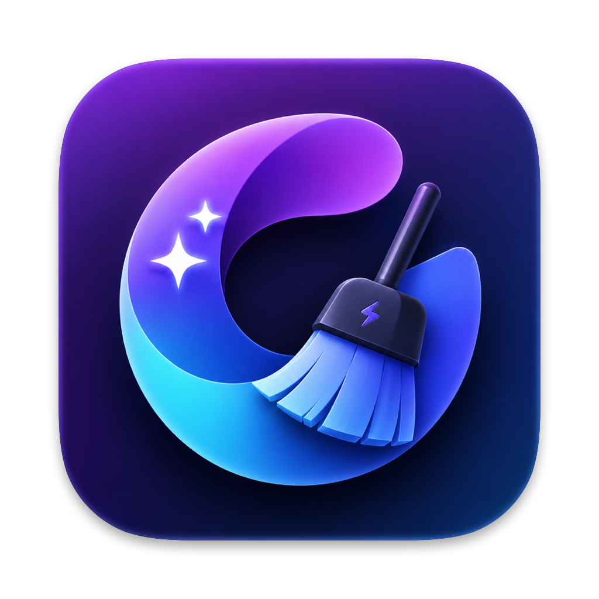

<p align="center">
  
</p>

<h1 align="center">Mac Sai</h1>

<p align="center">
  <strong>The open-source Mac cleaner, optimizer, and malware scanner.</strong><br>
  A free, Apple-notarized alternative to CleanMyMac, built with Swift 6 and SwiftUI.<br>
  <sub>Downloaded 100,000+ times. Free forever, with zero telemetry.</sub>
</p>

<p align="center">
  <strong>English</strong> | <a href="README.zh-CN.md">简体中文</a> | <a href="README.zh-Hant.md">繁體中文</a> | <a href="README.de.md">Deutsch</a> | <a href="README.fr.md">Français</a> | <a href="README.ru.md">Русский</a>
</p>

<p align="center">
  <a href="https://github.com/iliyami/MacSai/releases/latest"></a>
  <a href="https://github.com/iliyami/MacSai/stargazers"></a>
  <a href="https://formulae.brew.sh/cask/mac-sai"></a>
  <a href="https://github.com/iliyami/MacSai/releases/latest"></a>
  <a href="https://github.com/iliyami/MacSai/graphs/commit-activity"></a>
  <br>
  
  
  
  
  <a href="https://github.com/iliyami/MacSai/actions/workflows/ci.yml"></a>
  <a href="LICENSE"></a>
</p>

<p align="center">
  
</p>

<p align="center">
  <strong>Install in one command:</strong>
</p>

```bash
brew install --cask mac-sai
```

<p align="center">
  Or grab the <a href="https://github.com/iliyami/MacSai/releases/latest">latest DMG</a>. It is notarized by Apple, so it just opens, no right-click, no warnings, no Terminal.
</p>

<p align="center">
  <sub>No ads in the app, ever. This page has <a href="SPONSORS.md">one vetted sponsor slot</a>, and it is open.</sub>
</p>

---

## Why Mac Sai?

A full-featured Mac cleaner should not cost a yearly subscription or ask you to trust a black box with deep access to your files. Mac Sai gives you the whole toolkit, in the open.

- **Free, forever.** No subscription, no in-app purchases, no "upgrade to Pro", no nag screens. BSD-3 licensed.
- **Zero telemetry.** No analytics, no crash reporter, no trackers, no server to phone home to. And you do not have to take our word for it, [verify it yourself](#verify-no-telemetry-yourself) in two commands.
- **Every major CleanMyMac tool, in one app.** 22 modules across cleanup, protection, performance, applications, and disk insight, plus a menu-bar widget.
- **Safe by design.** Trash-first deletion, a protected-paths blocklist, symlink and TOCTOU guards, and a `SafetyGuard` that validates every path. It is built to never lose your data.
- **Apple-notarized and fully open source.** Your Mac verifies the signature every launch, and every line is here to read.

---

## Features at a glance

<table>
<tr>
<td width="33%" valign="top">

### 🧹 Cleanup
- **Smart Scan** (one click)
- **System Junk** (16+ categories)
- **Mail Attachments**
- **Trash Bins**
- **Project Junk** (build folders)
- **Disk Hogs** (Docker, simulators)
- **Clean History** (one-click Restore)

</td>
<td width="33%" valign="top">

### 🛡️ Protection
- **Malware Removal**
- **Privacy** (browsers)
- **Browser Extensions**
- **Saved Wi-Fi**
- **Permissions Overview**

</td>
<td width="33%" valign="top">

### ⚡ Performance
- **Optimization** (login items)
- **Maintenance** (system tasks)

</td>
</tr>
<tr>
<td width="33%" valign="top">

### 📦 Applications
- **Uninstaller** (+ Reset to Defaults)
- **Unused Apps**
- **Extensions** (panes, plug-ins)
- **Updater**

</td>
<td width="33%" valign="top">

### 🗂️ Files
- **Space Lens** (disk treemap)
- **Large & Old Files**
- **Duplicates** (+ Consolidate)
- **Shredder**

</td>
<td width="33%" valign="top">

### 📊 Menu Bar
- Live CPU / memory / disk / battery
- Network, uptime, swap
- Actionable recommendations

</td>
</tr>
</table>

---

## Features in detail

### 🧹 Cleanup
| Module | What it does |
|--------|------------|
| **Smart Scan** | One click runs cleanup, protection, and performance modules together with live progress, then shows exactly what it freed per module |
| **System Junk** | 16+ scan categories: user and system caches, logs, language files, broken preferences, broken login items, document versions, iOS backups, Xcode junk, package-manager / IDE / AI-tool caches, deleted-user leftovers, and **Universal Binary thinning** (finds fat Mach-O binaries carrying both arm64 and x86_64 and rewrites them to your native arch via `lipo`, honoring Cancel) |
| **Mail Attachments** | Finds cached attachments from Apple Mail, Outlook, and Spark |
| **Trash Bins** | Empties the Trash across every location, including external drives |
| **Project Junk** | Finds regenerable build folders across your projects: `node_modules`, `.next`, `dist`, Rust and Maven `target`, Gradle `build`, Python virtualenvs, and CocoaPods `Pods`. A folder only counts when the files next to it confirm the project type, and `dist` and `Pods` only when your `.gitignore` names them. Everything goes to the Trash |
| **Disk Hogs** | Shows how much space Docker and Xcode simulators take. Prunes stopped containers, dangling images, and dangling build cache (each behind a confirmation), and deletes unavailable simulators and old simulator runtimes. Docker volumes and the newest runtime for each platform are never touched |
| **Clean History** | Lists your recent cleans (the last 30 days, up to 20) and puts a whole clean back from the Trash in one click. The history stays on your Mac in `~/Library/Logs/MacClean/clean-history.json`, readable only by your user account, and is never sent anywhere |

### 🛡️ Protection
| Module | What it does |
|--------|------------|
| **Malware Removal** | Signature-based scanning at 3 depths (Quick / Balanced / Deep): launch agents and daemons, app bundles, browser extensions, and known adware/malware patterns. Exact-hash matching against Apple's XProtect signatures already on your Mac, offline, plus an optional MalwareBazaar (abuse.ch) hash feed. Safari extensions on Apple's blocklist and MalwareBazaar matches are listed for review, never pre-selected (not an antivirus, and it says so) |
| **Privacy** | Cleans Safari, Chrome, and Firefox history, cookies, and cache, with time filters. Safari **bookmarks are never touched** |
| **Browser Extensions** | Lists the extensions installed in Safari, Chrome, Brave, Edge, Arc, and Firefox. Chromium and Firefox extensions you installed yourself can go to the Trash while that browser is closed; ones installed by policy or by the browser itself are shown but left alone. Safari extensions link to Safari's settings |
| **Saved Wi-Fi** | Lists your preferred wireless networks and forgets the ones you pick |
| **Permissions Overview** | A read-only, by-app view of which privacy (TCC) grants each app holds, the angle System Settings does not give you. Every action deep-links to System Settings, which owns the toggles |

### ⚡ Performance
| Module | What it does |
|--------|------------|
| **Optimization** | Manage login items and launch agents with per-item enable/disable |
| **Maintenance** | System tasks: free RAM, run maintenance scripts, verify the startup disk, rebuild Launch Services, reindex Spotlight, flush DNS, thin Time Machine snapshots. Tasks are tagged by severity, "Run Safe Tasks" is sequential, and the admin password is asked **once** |

### 📦 Applications
| Module | What it does |
|--------|------------|
| **Uninstaller** | A pattern-matching engine that finds every associated file across 17+ Library subdirectories (including apps nested in vendor subfolders). Complete removal, **Reset to Defaults** (wipe an app's caches and preferences while keeping the app), and unused-app detection |
| **Unused Apps** | Finds apps you have not opened in 3, 6, or 12 months, using Spotlight's last-used date, sorted by size. Running apps are never listed, and when Spotlight has no usage data it says so instead of guessing. One click hands an app to the Uninstaller |
| **Extensions** | Review third-party preference panes, Internet Plug-Ins, and Safari extensions. User-installed panes and plug-ins can go to the Trash |
| **Updater** | Checks installed apps for updates via their own Sparkle appcast feeds (reads version info only, sends nothing about you) |

### 🗂️ Files
| Module | What it does |
|--------|------------|
| **Space Lens** | Squarified-treemap visualization of disk usage with drill-down navigation |
| **Large & Old Files** | Finds files over 50 MB, sorted by size and last access date |
| **Duplicates** | Progressive detection (size grouping, partial SHA-256, full hash, inode verification), plus a **Consolidate** mode that reclaims space with APFS copy-on-write clones without deleting a single copy |
| **Shredder** | Secure file erasure with standard, permanent, and secure-overwrite modes |

### 📊 Menu Bar Widget

<p align="center">
  
</p>

A glassmorphism menu-bar widget that puts your Mac's vitals one click away. It is an independent process that launches at login and is toggled from the app's sidebar, so you never have to open the main window just to check in.

- **Live stat rings**: CPU load, memory pressure, disk usage, and battery in a 2x2 ring grid (`host_processor_info`, `vm_statistics64`, APFS capacity, IOKit power source), color-graded green to amber to red
- **Configurable readout**: show free disk, GPU usage, memory usage, or battery temperature; the choice persists, and unavailable sensors show `--`
- **Network, uptime, and swap**: real-time up/down throughput, system uptime, swap usage
- **Recommendations**: actionable, dismissible tips ("User caches grew to 2.52 GB, run System Junk"), one tap to act, suppressed for 30 days once dismissed
- **Protection status**: last malware-scan time and threat count, color-coded by freshness
- **Connected devices**: external volumes (with free space) and displays at a glance
- **Health alerts**: throttled, opt-in notifications when the disk runs critically low or memory pressure stays high

### ⌨️ Keyboard shortcuts

| Shortcut | Action |
|----------|--------|
| **⌘R** | Start a scan in the current module |
| **⌘K** | Clean the current selection (when results are showing) |
| **⌘1 to ⌘9** | Jump to the first nine sidebar modules |
| **⌘,** | Open Settings |

---

## How Mac Sai compares

|  | Mac Sai | CleanMyMac | Pearcleaner | PureMac | OnyX | Mole |
|---|:---:|:---:|:---:|:---:|:---:|:---:|
| **Price** | Free | $39.95/yr | Free | Free | Free | Free (CLI) |
| **Open source** | ✅ BSD-3 | ❌ | ✅ Fair-code | ✅ MIT | ❌ | ✅ MIT |
| **Telemetry** | ❌ None | ⚠️ Yes | ❌ None | ❌ None | ❌ None | ❌ None |
| **Native GUI app** | ✅ | ✅ | ✅ | ✅ | ✅ | ❌ CLI (paid GUI separate) |
| **Smart Scan (one-click)** | ✅ | ✅ | ❌ | ➖ Partial | ❌ | ➖ Interactive CLI |
| **System Junk (16+ categories)** | ✅ | ✅ | ➖ | ✅ | ➖ Limited | ✅ |
| **Universal Binary thinning** | ✅ | ✅ | ❌ | ❌ | ❌ | ❌ |
| **Malware scanner** | ✅ | ✅ | ❌ | ❌ | ❌ | ❌ |
| **Browser privacy cleaner** | ✅ | ✅ | ❌ | ❌ | ➖ | ❌ |
| **Uninstaller with leftover detection** | ✅ | ✅ | ✅ Focus | ❌ | ❌ | ✅ |
| **Duplicate finder (+ consolidation)** | ✅ | ➖ | ❌ | ❌ | ❌ | ❌ |
| **Disk treemap visualizer** | ✅ | ❌ | ❌ | ❌ | ❌ | ➖ Analyzer |
| **Menu bar system monitor** | ✅ | ✅ Menu | ❌ | ❌ | ❌ | ❌ |
| **Maintenance scripts** | ✅ | ✅ | ❌ | ❌ | ✅ Strong | ➖ |
| **Notarized by Apple** | ✅ | ✅ | ✅ | ✅ | ✅ | N/A |
| **macOS version** | 14+ | 13+ | 13+ | 13+ | varies | varies |

> CleanMyMac is a great product, and the people who want a polished, supported experience should happily pay for it. Mac Sai is for everyone who would rather have transparent source code and zero subscription.

---

## Interface languages

Choose System, Deutsch, Français, Русский, 简体中文, 繁體中文, or English in Settings → Interface Language. German, French, and Traditional Chinese translate static interface strings; interpolated messages retain the English wording and plural rules for now (Traditional Chinese falls back to Simplified). The main window and menu-bar widget share the language preference.

## Installation

### Homebrew (recommended)

Mac Sai is in the official Homebrew cask, so no tap is needed:

```bash
brew install --cask mac-sai
```

It is notarized by Apple, so it launches from Spotlight or Applications with no warnings and no extra steps.

<details>
<summary><strong>Other ways to install</strong> (one-line script, DMG, build from source)</summary>

<br>

**One-line installer**

```bash
curl -fsSL https://raw.githubusercontent.com/iliyami/MacSai/main/scripts/install.sh | bash
```

Downloads the latest DMG and installs the app to `/Applications`.

**DMG download**

Grab the latest DMG from [Releases](https://github.com/iliyami/MacSai/releases/latest) and drag Mac Sai to your Applications folder.

**Build from source**

```bash
git clone https://github.com/iliyami/MacSai.git
cd MacSai
swift build
swift test                     # run the full 1,048-test suite
bash scripts/build-dmg.sh      # build a local DMG (unsigned)
```

Requires the Swift 6 toolchain (Xcode 16+).

**Installed via the old tap?**

Mac Sai is in the official cask now, so you can drop the tap: `brew untap iliyami/macsai` (your installed app and future `brew upgrade` are unaffected).

</details>

### Granting Full Disk Access

A few modules (Mail Attachments, Privacy, Malware) need Full Disk Access to scan protected areas:

1. Open **System Settings, Privacy & Security, Full Disk Access**
2. Click **+** and add **Mac Sai.app**
3. Restart Mac Sai

### Uninstalling

Homebrew install:

```bash
brew uninstall --zap --cask mac-sai
```

DMG or manual install (also handles a Homebrew install):

```bash
curl -fsSL https://raw.githubusercontent.com/iliyami/MacSai/main/scripts/uninstall.sh | bash
```

Both remove Mac Sai plus its preferences, caches, logs, and database under `~/Library`.

---

## Signed, notarized, and yours to trust

Mac Sai is code-signed with an Apple **Developer ID** and **notarized by Apple**. That matters more for a cleaning app than for almost anything else you install, because you are about to give it deep access to your files, and you deserve to know that what runs on your Mac is genuinely ours and untampered with. All of this is enforced by your own Mac, not just promised by us:

- **Apple has scanned it.** Every release is submitted to Apple and checked for malware before it ships.
- **It cannot be tampered with.** The signature is a cryptographic seal over every file; change a single byte and macOS refuses to open it.
- **It is provably from us.** The signature is tied to our Apple Developer identity, so no one else can ship something your Mac accepts as Mac Sai.
- **It just works.** No Gatekeeper warnings, no right-click-to-open, no Terminal.

Put together with a fully open source, this is a chain of trust you do not take on faith: the code is public, we sign every release, Apple verifies it, and your Mac re-checks the seal every time you open the app.

### Verify no telemetry yourself

Do not take our word for it. Both the source and the running process are checkable.

**1. Search the source for networking APIs**

```bash
rg -n 'URLSession|NSURLConnection|Sparkle|SecTrustEvaluate' Sources --glob '*.swift'
```

The optional network paths are disclosed below. Local cleaning does not upload scan results or file lists:

- `Sources/MacClean/Services/SelfUpdateController.swift`: Sparkle checks the HTTPS feed sealed into the signed app and downloads signed release notes and update archives. Automatic checks and automatic download/install are separate settings; system profiling and release-note JavaScript are disabled. See [update setup](docs/IN_APP_UPDATES.md). For configured direct installations, automatic update checks are on by default and run once a day; each request includes the app and Sparkle versions in the User-Agent, and checks can be turned off in Settings.
- `Sources/MacCleanKit/UpdateChecker.swift`: Homebrew update checks and the release-page fallback for builds without a configured signed feed
- `Sources/MacClean/Modules/Updater/UpdaterModule.swift`: the user-driven check of *other apps'* Sparkle feeds when you open the Updater
- `Sources/MacCleanKit/MalwareBazaarFeed.swift`: the opt-in MalwareBazaar hash download. It only runs when you add your own abuse.ch Auth-Key and press Update Now in Settings > Malware Databases. Each request sends only your Auth-Key and the query, never file hashes or paths. When a downloaded hash matches a signed file, macOS asks Apple whether its signing certificate was revoked, the same check Gatekeeper makes; that request is about the certificate, not your files

There is no analytics, crash reporter, or tracker SDK anywhere in the codebase.

**2. Watch the live process**

```bash
(
MACSAI_APP=$(cd "/Applications/Mac Sai.app" && pwd -P) || exit 1
MACSAI_PIDS=$(ps -ww -axo pid=,comm= | awk -v bundle="$MACSAI_APP/" '
  { pid=$1; sub(/^[[:space:]]*[0-9]+[[:space:]]+/, "")
    if (index($0, bundle) == 1) print pid }' | paste -sd, -)
if [ -n "$MACSAI_PIDS" ]; then
  ps -p "$MACSAI_PIDS" -o pid=,comm=
  lsof -nP -a -p "$MACSAI_PIDS" -i
else
  echo "No running executables from this Mac Sai bundle"
fi
)
```

This snapshot selects PIDs by executable paths inside the chosen app bundle, so unrelated Installer/Updater processes are excluded. Sparkle helpers copied elsewhere and macOS trust services are outside this snapshot; use a process-aware firewall to observe those. Run it while checking or downloading an update to catch short-lived connections.

With update checks/downloads and optional malware verification inactive, local cleaning opens no network connection. Include Sparkle’s child processes when observing an update; Apple certificate checks run through macOS trust services. Little Snitch or LuLu can show these connections too.

**3. Inspect the binary you actually installed**

For a DMG or Homebrew installation, this loop needs only macOS command-line tools, with no source checkout or Python. It reads all seven bundled binaries and lists common network imports, static URLs and tracker strings for manual inspection:

```bash
(
MACSAI_APP="/Applications/Mac Sai.app"
MACSAI_SPARKLE="$MACSAI_APP/Contents/Frameworks/Sparkle.framework/Versions/B"
for MACSAI_BINARY in \
  "$MACSAI_APP/Contents/MacOS/MacClean" \
  "$MACSAI_APP/Contents/Library/LoginItems/MacCleanMenu.app/Contents/MacOS/MacCleanMenu" \
  "$MACSAI_SPARKLE/Sparkle" "$MACSAI_SPARKLE/Autoupdate" \
  "$MACSAI_SPARKLE/Updater.app/Contents/MacOS/Updater" \
  "$MACSAI_SPARKLE/XPCServices/Downloader.xpc/Contents/MacOS/Downloader" \
  "$MACSAI_SPARKLE/XPCServices/Installer.xpc/Contents/MacOS/Installer"
do
  printf '\n%s\n' "$MACSAI_BINARY"
  MACSAI_IMPORTS=$(nm -uj "$MACSAI_BINARY") || exit 1
  printf '%s\n' "$MACSAI_IMPORTS" | grep -Ei \
    'URLSession|URLConnection|CFNetwork|Network|nw_|DNSService|NetService|curl_|^_(socket|connect|connectx|send|recv)([$]|$)' || true
  MACSAI_STRINGS=$(strings -a "$MACSAI_BINARY") || exit 1
  printf '%s\n' "$MACSAI_STRINGS" | grep -Ei \
    '://|sentry|firebase|mixpanel|amplitude|bugsnag|crashlytics|posthog|appsflyer' || true
done
)
```

These listings are not a pass/fail audit or proof that every runtime destination is visible. For the complete component inventory, explicit allowlists and bundled privacy settings, use the automated check below.

Run the check from a source checkout matching the installed version. It inspects the actual app bundle, including the main executable, menu helper, `Sparkle.framework`, `Autoupdate`, `Updater.app`, `Downloader.xpc`, and `Installer.xpc`:

```bash
bash scripts/check-network-surface.sh "/Applications/Mac Sai.app"
```

Expected: seven Mach-O files pass. Missing or unexpected binaries, unlisted network imports or static URLs, and tracker markers fail the check. URLSession imports are allowed in Mac Sai, its menu helper, Sparkle, and Downloader; the other Sparkle helpers have no allowed network imports. Sparkle’s documentation links and XML namespace are explicitly identified, not treated as download endpoints.

The script also prints the bundled `SUFeedURL` and verifies the signed-feed, pre-extraction, and privacy settings. Check that feed’s archive/release-note destinations and the other-app feeds you request against the live connections above. The fallback endpoints are `api.github.com/repos/iliyami/MacSai/releases/latest` and `formulae.brew.sh/api/cask/mac-sai.json`; the opt-in malware endpoint is `mb-api.abuse.ch/api/v1/`. Project/support links and browser-settings links open only when requested. The same complete-bundle check runs during packaging; CI checks both built executables and all five pinned Sparkle binaries. [Check implementation and explicit allowlists](scripts/check-network-surface.py).

---

## Architecture

```
Mac Sai
├── MacClean          Main SwiftUI app (22 modules)
├── MacCleanKit       Shared framework (models, constants, protocols)
├── MacCleanHelper    XPC privileged helper (LaunchDaemon for root ops)
└── MacCleanMenu      Menu-bar monitor (independent process)
```

### Tech stack

| Layer | Technology |
|-------|-----------|
| Language | Swift 6 with strict concurrency |
| UI | SwiftUI + AppKit hybrid |
| Concurrency | Actors, TaskGroup, async/await, `@Sendable` |
| Database | GRDB.swift (SQLite) with WAL mode |
| File scanning | `URLResourceKey` prefetching on APFS |
| Incremental updates | FSEvents with historical replay |
| Privileged ops | SMAppService + NSXPCConnection |
| System stats | Mach APIs (`host_processor_info`, `vm_statistics64`, `proc_pidinfo`) |

### Safety model

Mac Sai is designed to **never cause data loss**:

- **Protected-paths blocklist**: `/System`, `/usr`, `/bin`, `/sbin`, and Apple system apps are untouchable, with macOS firmlinks canonicalized so symlink-redirect detection does not false-positive on legitimate system paths
- **Pre-scan cleanability filter**: items the current process could not trash (root-owned children of system caches, data-vaulted `~/Library/Caches/com.apple.*` dirs) are dropped at scan time so they never appear as cleanable
- **Trash-first deletion**: every removal goes to the Trash by default, and a dry-run mode previews without touching anything
- **TOCTOU prevention**: symlinks are re-resolved immediately before deletion
- **Excluded Folders**: pick folders in Settings that scans skip entirely, and `SafetyGuard` additionally refuses to delete anything under them
- **Chunked, cancellable cleanup**: large selections split into 5k-item chunks honoring cancellation between chunks, and scans return to idle within about a second when you hit Cancel
- **In-app activity log**: every error during a clean is logged with its full path, viewable and copyable from the post-clean screen, auto-pruned after 30 days
- **Kernel-enforced XPC gate**: the privileged helper uses `NSXPCListener.setCodeSigningRequirement` so the kernel itself rejects any connection whose code signature does not match the app's identifier and team

---

## Tests

```bash
swift test
```

The XCTest suite has **1,048 tests** and treats `SafetyGuard` and `CleaningEngine` (the death-and-life files) as must-be-perfect: adversarial coverage of symlinks, path traversal, NULL bytes, SIP, protected apps, file-count caps, TOCTOU, and idempotence, plus integration coverage of dry-run / trash / permanent cleaning, the scan state machine, every System Junk category, the treemap math, the uninstaller matching engine, duplicate detection, appcast parsing, and full end-to-end fixture-to-clean cycles. Fixtures (`withTempHome`, `withFakeApp`, `withFakePlist`) keep every test off your real home directory.

---

## Contributing

Contributions are very welcome. Read the [Contributing Guidelines](CONTRIBUTING.md), then:

1. Fork the repo and create a feature branch
2. Make your change (one focused change per PR keeps review easy)
3. Run `swift test`
4. Open a Pull Request

There is also an open [feature vote](https://github.com/iliyami/MacSai/issues/55): 👍 the tools you want built next.

## License

BSD 3-Clause. See [LICENSE](LICENSE). You may use, modify, and redistribute the code, provided you keep the copyright and license text and do not use the "Mac Sai" name or contributors' names to endorse derived products without permission.

## Acknowledgments

Inspired by the open-source Mac utility community:

- [Pearcleaner](https://github.com/alienator88/Pearcleaner): app uninstaller patterns
- [Mole](https://github.com/tw93/Mole): cleanup categories
- [Tencent Lemon Cleaner](https://github.com/Tencent/lemon-cleaner): modular architecture
- Squarified Treemap algorithm by Bruls, Huizing, and van Wijk (2000)

## Support and sponsors

Mac Sai is free and stays free: no paid tier, no ads, no tracking. If it saved you from a cleaner subscription, you can [buy me a coffee ☕](https://buymeacoffee.com/iliyami). It keeps the releases signed, notarized, and coming.

### Sponsor slot

Mac Sai has **one** sponsor slot, shown here and at the top of this page, in every language of this README.

<div align="center">
<table>
  <tr>
    <td align="center" width="25%"><h3>100,000+</h3><sub>downloads</sub></td>
    <td align="center" width="25%"><h3>2,000+</h3><sub>GitHub stars</sub></td>
    <td align="center" width="25%"><h3>17,000</h3><sub>page views a month</sub></td>
    <td align="center" width="25%"><h3>6</h3><sub>README languages</sub></td>
  </tr>
</table>
</div>

Most visitors are developers and Mac power users, arriving mostly from Google search, then YouTube, GitHub and Reddit.

- **One sponsor at a time**, so your name is not lost in a wall of logos.
- **Vetted.** Developer tools, privacy and security products, and Mac apps that respect their users. No cleaners or "optimizers", no crypto, no affiliate VPN deals, nothing that tracks people.
- **Never inside the app.** Mac Sai has no ads and no telemetry, and no sponsor changes that.

<p align="center">
  <strong>This spot is open.</strong> <a href="mailto:iliya.mi78@gmail.com?subject=Mac%20Sai%20sponsor">Become the sponsor →</a><br>
  <sub>Audience details and how to apply: <a href="SPONSORS.md">SPONSORS.md</a></sub>
</p>

## Star History

<p align="center">
  <a href="https://www.star-history.com/?repos=iliyami%2FMacSai&type=date&legend=top-left">
    <picture>
      <source media="(prefers-color-scheme: dark)" srcset="https://api.star-history.com/chart?repos=iliyami/MacSai&type=date&theme=dark&legend=top-left&sealed_token=U-awhgge-qJwqcwRMpeYAooRYIriMPXuNrQErHZuAQsbmKYoo3D7oum-5zvqFjZlP77FXRFg56nh-1Ie9oWSBAPeS7-NUe70kSI-3XJ_Ce97vHA0OQcqEKhE0STA4FhfJ-bkteG7lb2xAVJWcLPtIJalJjJuhE2nrgA4rrcQbs6cJPk2-sbuJw76SARx" />
      <source media="(prefers-color-scheme: light)" srcset="https://api.star-history.com/chart?repos=iliyami/MacSai&type=date&legend=top-left&sealed_token=U-awhgge-qJwqcwRMpeYAooRYIriMPXuNrQErHZuAQsbmKYoo3D7oum-5zvqFjZlP77FXRFg56nh-1Ie9oWSBAPeS7-NUe70kSI-3XJ_Ce97vHA0OQcqEKhE0STA4FhfJ-bkteG7lb2xAVJWcLPtIJalJjJuhE2nrgA4rrcQbs6cJPk2-sbuJw76SARx" />
      
    </picture>
  </a>
</p>

<p align="center">
  <strong>Mac Sai is free software built by the community, for the community.</strong><br>
  If it saved you from a subscription, a ⭐ helps others find it, and a <a href="https://buymeacoffee.com/iliyami">coffee ☕</a> keeps it going.
</p>
